  

 

<h3 align="center">My Contributions</h3>

  <picture>
    <source media="(prefers-color-scheme: dark)" srcset="https://raw.githubusercontent.com/Robert-Porchas/Robert-Porchas/output/github-contribution-grid-snake-dark.svg" />
    <source media="(prefers-color-scheme: light)" srcset="https://raw.githubusercontent.com/Robert-Porchas/Robert-Porchas/output/github-contribution-grid-snake.svg" />
    
  </picture>

<!--
Terminal: adapted from beydemirfurkan/awesome-github-profile's Typewriter Intro.
https://github.com/beydemirfurkan/awesome-github-profile/tree/main/templates/02-animated/typewriter-intro
The upstream license is preserved in assets/typewriter-intro.svg.

Snake: https://github.com/Platane/snk
The snake workflow publishes both SVGs to the root of the output branch.
Images become available after the first successful workflow run.
-->
